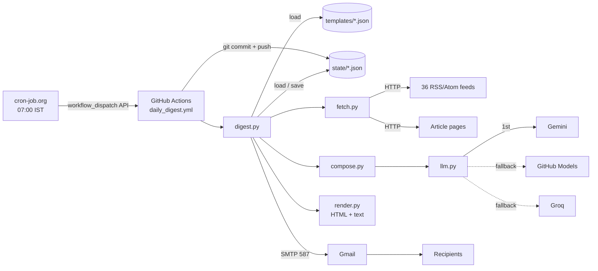
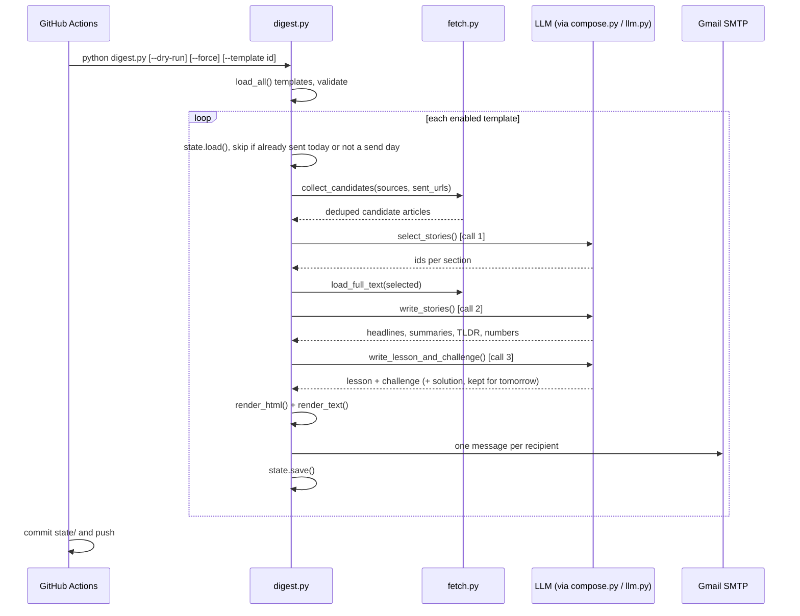
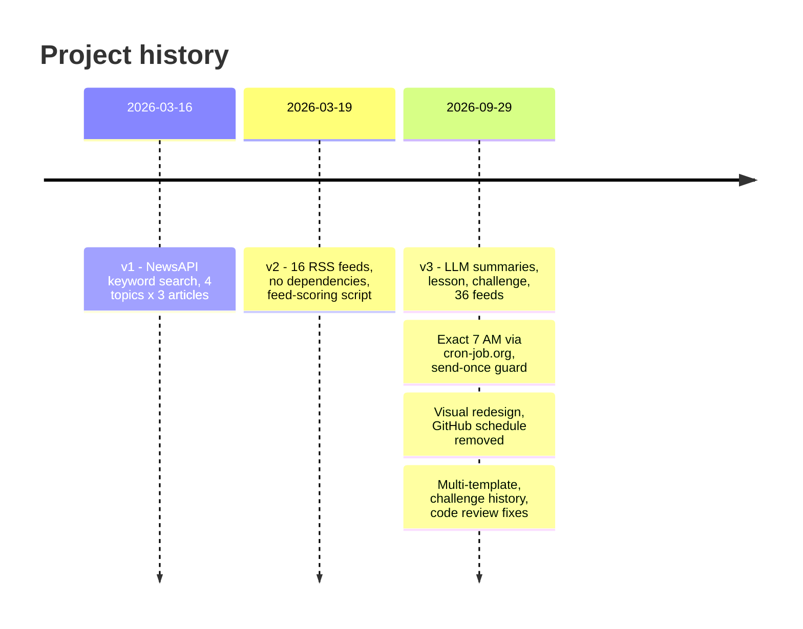

# Daily Digest: project brief

A handbook-style description of how this project works, built only from the code, config and git history in this repository. Where something can't be confirmed from those, it says **unknown**.

Figures marked "as of 2026-10-19" come from the GitHub Actions run history and the committed state file of the original private deployment, before the code was published. This public repo starts with empty state.

---

## 1. Summary

**What it does.** Every morning a GitHub Actions job reads 36 RSS and Atom feeds, asks a free-tier LLM to pick and summarise the most important stories, and emails a designed HTML digest. Each email also includes a short lesson from a structured product or tech curriculum, plus a 15-minute challenge whose solution arrives in the next day's email. The goal (from `README.md`) is "a daily email ... that keeps you current and teaches you something, all inside the email", so the reader never has to click through to the source sites.

**Who it's for.** A small private recipient list, kept in a secret rather than in the repo. The prompt audience in `templates/daily.json` is "a busy professional who wants to stay current on product, tech, AI, fintech and global markets, and keep building their fundamentals". The template system lets the same pipeline serve other audiences and recipient lists.

**Why it was built.** The original repo description is "Daily AI News". The September 2026 rebuild commit gives the reasons for that rebuild: the old email was a list of links with short teasers, so the rebuild adds LLM summaries, a daily lesson and a challenge, all on a free stack. No longer write-up of the original motivation is recorded.

**Status: live.**
- Running daily since 2026-03-16 (first workflow run).
- The current architecture has been live since 2026-09-29.
- As of 2026-10-19, the most recent run (2026-10-19, 01:30 UTC) succeeded and the state file shows issue #20 of the current format.

---

## 2. The big picture

| Component | What it does |
|---|---|
| **cron-job.org** (external scheduler) | Calls GitHub's workflow-dispatch API once a day at 07:00 Asia/Kolkata. Named in `README.md` and in the comment at the top of `.github/workflows/daily_digest.yml`. Its own configuration lives outside this repo. |
| **GitHub Actions** | Runs the job on `ubuntu-latest` with Python 3.11. Workflow: `.github/workflows/daily_digest.yml`. |
| **Python pipeline** | `digest.py` orchestrates everything. `fetch.py` handles feeds and article pages, `compose.py` the prompts, `llm.py` the LLM client, `render.py` the email HTML and text, and `templates.py` / `state.py` / `curriculum.py` the config and memory. |
| **RSS/Atom feeds** | 36 public feeds, listed in `templates/daily.json`. Parsed with `feedparser` 6.0.14 (`requirements.txt`). |
| **Article pages** | For the selected stories, the full article page is downloaded and its main text extracted with `trafilatura` 2.2.0. |
| **LLM providers** (OpenAI-compatible APIs) | Tried in order: Google Gemini, then GitHub Models, then Groq (optional), from `llm.py`. Used to pick stories, write summaries, and write the lesson and challenge. |
| **Gmail SMTP** | Sends the email via `smtp.gmail.com:587` with STARTTLS and an app password (`digest.py`, `send_email`). |
| **Git repo as storage** | Per-template state in `state/<id>.json`. The workflow commits it back after each run. |

### How they connect



---

## 3. One run, start to finish

### Trigger

- **Workflow trigger:** `workflow_dispatch` only (`.github/workflows/daily_digest.yml`). There is no GitHub `schedule` trigger. It was removed on 2026-09-29 because GitHub started scheduled runs hours late (see section 12).
- **Daily caller:** cron-job.org at 07:00 Asia/Kolkata (`README.md`). Observed start times since 2026-09-30 are 01:30:21 to 01:30:31 UTC every day, which is 07:00 IST plus about 25 seconds.
- **Manual inputs:** `dry_run` (boolean), `force` (boolean) and `template` (string), defined in the workflow file.
- **Job limits:** `timeout-minutes: 20` and a concurrency group named `daily-digest` with `cancel-in-progress: false`, so two runs never overlap (workflow file).

### Steps



| # | Step | Where | Input → output | Limits |
|---|---|---|---|---|
| 1 | **Load templates** | `templates.py` `load_all()` / `_parse()` | `templates/*.json` → validated `Template` objects | An invalid file stops the run before anything is sent. Each enabled template must have at least 1 recipient. Topic keys `top` and `quick_hits` are reserved. |
| 2 | **Load state, guard** | `digest.py` `run_template()`, `state.py` `load()` | `state/<id>.json` → dict | Skips if `last_sent` is today or today isn't in `days`, unless `--force` or `--dry-run`. |
| 3 | **Fetch feeds** | `fetch.py` `fetch_sources()` → `fetch_feed()` | feed URLs → parsed items | 12 parallel workers. 15 s HTTP timeout (`http_get` default). Each feed is fetched once per run even if several templates share it. |
| 4 | **Filter by time** | `fetch.py` `fetch_feed()` | entries → fresh items | Only the first 30 entries per feed are read. Window is 48 h, or 7 days for sources marked `slow` (`FAST_WINDOW`, `SLOW_WINDOW`). Items dated more than 6 h in the future are dropped. Only the newest 5 per source are kept (`MAX_PER_SOURCE`). |
| 5 | **Deduplicate** | `fetch.py` `collect_candidates()` | items → candidates (`Article`) | Duplicates are detected three ways: by normalized URL (tracking params such as `utm_*`, `ref`, `fbclid` and `gclid` removed, fragment removed, trailing slash removed, host lowercased), by title similarity (`difflib` ratio > 0.85), and against URLs sent in the last 30 days. |
| 6 | **Rank / select** | `compose.py` `select_stories()` (LLM call 1) | candidate list (id, topic, source, title, teaser) → ids per section | The LLM picks 3 top stories, up to 2 more per topic, and 6 quick hits. Teasers are cut to 220 chars, or 70 on small-context providers. The candidate list fills the provider's character budget minus 4,000 chars. Unknown or duplicate ids are discarded. |
| 7 | **Full text** | `fetch.py` `load_full_text()` → `_extract_page()` | selected story URLs → article text + `og:image` | 8 parallel workers and a 20 s timeout. Falls back to the feed body if the extracted text is shorter. Quick hits don't get full text. |
| 8 | **Summarise** | `compose.py` `write_stories()` (LLM call 2) | story texts → headline, summary, "why it matters", term, TL;DR, 3 numbers | Per-story text is capped at `min(6000, (budget − 6000) / n)` chars, with a floor of 600. Quick-hit teasers are capped at 200 chars. |
| 9 | **Lesson + challenge** | `digest.py` `build_learning()` → `compose.py` `write_lesson_and_challenge()` (LLM call 3) | next curriculum topic, covered topics (last 60), recent challenges (last 20), today's headlines (first 15) → lesson + challenge | On a forced same-day resend, the day's lesson and challenge are reused rather than regenerated. |
| 10 | **Reveal solutions** | `digest.py` `run_template()` | stored challenges → solution blocks | Every earlier unrevealed challenge is revealed, up to 3 per email (`MAX_REVEALS`). |
| 11 | **Format** | `render.py` `render_html()` / `render_text()` | digest dict → HTML + plain text | Table-based, inline-styled HTML (Gmail strips SVG and scripts). Max 640 px wide. Read time = words / 220, minimum 3 min (`digest.py` `read_minutes`). |
| 12 | **Send** | `digest.py` `send_email()` | HTML + text → one MIME message per recipient | One SMTP login, 60 s timeout. A failed recipient doesn't stop the others. If the connection drops, the remaining recipients are marked undelivered. |
| 13 | **Save state** | `state.py` `save()`, then the workflow's "Save state" step | dict → `state/<id>.json` → git commit "Update digest state" | Runs even if a template failed (`if: !cancelled() && !inputs.dry_run`). Rebases and pushes to the branch the run started on. |

**Observed run time**, as of 2026-10-19 (GitHub Actions, current version, 21 runs): median **227 s**, minimum 87 s, maximum 565 s. The "Run digest" step takes almost all of it; on 2026-10-19 it took 5 min 43 s of a 6 min run.

---

## 4. Sources

**36 feeds across 5 topics** (`templates/daily.json`). "(7d)" marks a `slow` source with a 7-day window; the rest use 48 hours.

| Topic | Count | Sources |
|---|---|---|
| AI | 11 | Simon Willison, Latent Space (7d), Import AI (7d), Interconnects (7d), Hugging Face Blog (7d), OpenAI News (7d), Google DeepMind (7d), Google AI Blog (7d), MIT Tech Review AI, The Verge AI, TechCrunch AI |
| Tech | 6 | Hacker News (250+ points), Ars Technica, The Pragmatic Engineer (7d), ByteByteGo (7d), Stratechery (7d), Martin Fowler (7d) |
| Product | 5 | Lenny's Newsletter (7d), Product Growth (7d), First Round Review (7d), Andrew Chen (7d), Elena Verna (7d) |
| Fintech | 7 | Fintech Brainfood (7d), This Week in Fintech (7d), Net Interest (7d), Finextra, Payments Dive, Entrackr, Inc42 |
| Global Markets | 7 | Rest of World, The Economist Finance, BBC Business, Guardian Business, CNBC World, Nikkei Asia, ET Markets |

That makes 19 sources with a 7-day window and 17 with a 48-hour window.

**How items are chosen**
- **Time window:** 48 h, or 7 days for `slow` sources. Items with no date are kept (`fetch.py`).
- **Per source:** the newest 5 of the first 30 entries.
- **Deduplication:** normalized URL, title similarity above 0.85, and not sent in the last 30 days (`state.py` `URL_RETENTION_DAYS = 30`).
- **Ranking:** there are no numeric scores or weights in the current version. The LLM acts as editor, following prompt rules in `compose.py`:
  - prefer launches, research results, data, regulation, deals and deep analysis
  - skip listicles, sponsored posts, podcast ads, minor funding rounds and clickbait
  - when several sources cover one event, pick the most informative one
  - each topic also has a `focus` line in the template (for example, fintech favours "payments, lending, banking, regulation, and Indian fintech including UPI and RBI moves")
- **Feed health:** `evaluate_feeds.py` (run by the "Check Feed Health" workflow) prints item counts and errors for every source. It doesn't score feeds.

**Observed volume**, as of 2026-10-19 (from `state/daily.json` `sent_urls`): **17 to 19 items per email** (median 19) across the 20 issues from 2026-09-30 to 2026-10-19. The 19-item maximum is 3 top + up to 2 × 5 topics + 6 quick hits. The number of candidates fetched per run is **unknown**: it's printed to the job log, and the logs couldn't be retrieved for this brief.

---

## 5. AI use

**Providers and models** (`llm.py` `_providers()`). All are called through OpenAI-compatible chat-completions endpoints with `temperature` 0.4 and `response_format: json_object`.

| Order | Provider | Enabled by | Default models (overridable) | Prompt budget |
|---|---|---|---|---|
| 1 | Google Gemini | `GEMINI_API_KEY` | `gemini-flash-latest`, then `gemini-flash-lite-latest` (`GEMINI_MODELS`) | 300,000 chars |
| 2 | GitHub Models | `GITHUB_TOKEN` (provided by Actions, `models: read` permission) | `openai/gpt-4.1-mini` (`GITHUB_MODELS`) | 22,000 chars |
| 3 | Groq | `GROQ_API_KEY` (optional) | `llama-3.3-70b-versatile` (`GROQ_MODELS`) | 18,000 chars |

Which provider and model actually answered on each run is **unknown**, because it's only printed to the job logs. The state file shows a lesson and challenge were generated for every issue, which means at least one provider answered on every run.

**Three calls per template per run** (`compose.py`):
1. **Select:** "You are the editor of a daily briefing." The prompt gives the reader profile, the topic list with each topic's focus, and the selection rules. The input is one line per candidate: `id | topic | source | title | teaser`. The output is JSON of ids per section.
2. **Write stories:** for each story, a headline (max 14 words), a 3 to 4 sentence summary, a 1 to 2 sentence "why it matters", and one jargon term. It also writes 3 TL;DR lines, one-line quick hits (max 25 words), and up to 3 striking figures, which must be "stated in the source text".
3. **Lesson + challenge:** "You are a teacher writing the learning section of a daily email."
   - The lesson has a one-liner, 3 paragraphs, a worked example, a real-world tie-in, pitfalls, one line to remember, and one diagram (a flow, a bar chart or a comparison).
   - The challenge has a title, scenario, task, 2 hints, a difficulty from 1 to 3, and a solution: approach steps, a 120 to 200 word sample answer, "what good looks like" and common mistakes.
   - The challenge format rotates by weekday through 7 types: metrics, product sense, system design, estimation, fintech case, data/SQL, and strategy (`templates/daily.json`).

A shared style line asks for plain English with concrete facts and no em dashes. Any em dash that still appears is replaced in post-processing (`compose.py` `strip_em_dashes`).

**Failures and rate limits** (`llm.py` `json_call()`)
- **Retries:** HTTP 429, 500, 502, 503 and 504 are retried up to 3 attempts per model, sleeping 10 s and then 20 s. The request timeout is 180 s.
- **Fallback chain:** after that, the next model is tried, then the next provider.
- **News calls all fail:** the email becomes a **headlines-only edition** of the 3 newest items per topic, with feed teasers cut to 400 chars and a notice at the top (`digest.py` `build_news_fallback`).
- **Lesson call fails:** the email goes out without a lesson or challenge, the curriculum doesn't advance, and earlier solutions are still revealed.
- **Bad output:** malformed LLM output (unknown ids, missing fields, invalid chart data) is dropped field by field rather than failing the run (`digest.py`, `render.py`).

---

## 6. The output

**Format.** A multipart email with HTML and a plain-text alternative (`digest.py` `send_email`). The sender display name is the template's `name`, "Daily Digest" for the main template.

**Subject line.** `DD Mon: <lead headline, cut to 80 chars>` (`digest.py`), for example `19 Oct: <headline of the top story>`.

**Sections, in order** (`render.py` `render_html`):
1. **Dark header:** template name, issue number, read time, the date, topic chips with story counts, and a numbered TL;DR (3 lines).
2. **By the numbers:** up to 3 stat tiles.
3. **Top stories:** 3 large cards with the article image when available, a topic pill, headline, summary, a "Why it matters" box, a "Term" chip, and a source link.
4. **Topic sections:** AI, Tech, Product, Fintech and Global Markets, each with up to 2 smaller cards with thumbnails.
5. **Quick hits:** up to 6 one-liners.
6. **Learn:** the lesson topic, progress bars for each track (for example "Product 11/32"), the explanation, one diagram, a worked example, real-world tie-in, pitfalls, and a "Remember" line.
7. **Yesterday's challenge · Solution:** the original question, approach steps, a sample answer, "what good looks like" and common mistakes. A challenge that was skipped over is labelled "Challenge from Wed 30 Sep".
8. **Today's challenge:** difficulty dots, a "~15 min" tag, the scenario, the task and hints.
9. **Footer:** how many items were read from how many sources.

**Length.** Up to 19 news items plus a lesson and challenge. The read time is computed per email; observed values are **unknown** (not stored).

### Example (placeholder content)

```text
From: Daily Digest
Subject: 19 Oct: Example lab releases a smaller model that runs on phones

DAILY DIGEST · Issue #20 · 9 min read
Sunday, 19 October 2026            ● AI 4  ● Fintech 3  ● Tech 2 ...

TL;DR
 1. A placeholder sentence about the biggest AI story.
 2. A placeholder sentence about a payments regulation change.
 3. A placeholder sentence about a central bank decision.

BY THE NUMBERS   [ 41% | share of X ]  [ ₹1,800 | average Y ]  [ 9x | growth in Z ]

TOP STORIES
 [AI] Example lab releases a smaller model that runs on phones
 Three to four sentences of summary with the key facts and figures.
 WHY IT MATTERS  One or two sentences on the implication for the reader.
 TERM  Distillation: training a small model to copy a larger one.

QUICK HITS
 | One-line placeholder item. (Source name)

LEARN · Product · Lesson 11
 Prioritization frameworks: RICE, ICE, and their limits
 [Product ███░░░░░ 11/32]  [Tech ███░░░░░ 10/34]
 One-liner, three short paragraphs, a step-flow diagram, a worked example ...

YESTERDAY'S CHALLENGE · SOLUTION
 The question ... Approach 1-2-3 ... Sample answer ... Common mistakes ...

TODAY'S CHALLENGE   ●●○ Solid   ~15 min
 Scenario: a fictional company with concrete numbers.
 Your task: what to produce. The solution arrives in tomorrow's digest.
```

---

## 7. Data and state

| What | Where | Format | Kept for |
|---|---|---|---|
| Sent article URLs (URL → send date) | `state/<id>.json` → `sent_urls` | JSON | 30 days (`state.py` `URL_RETENTION_DAYS`) |
| Last send date, issue number | `last_sent`, `issue` | JSON | Overwritten each send |
| Curriculum position per track, next track | `curriculum.positions`, `curriculum.next` | JSON | Permanent |
| Lessons covered | `covered_concepts` | JSON list | Not trimmed; grows by 1 per issue |
| Challenges with solutions and reveal status | `challenges` | JSON list | Last 60 (`MAX_CHALLENGES`) |
| Challenge titles (so the LLM avoids repeats) | `challenge_history` | JSON list | Last 90 |
| Today's lesson (reused on a same-day resend) | `today` | JSON | Overwritten daily |
| Feed and page cache | memory only (`fetch.py` `_feed_cache`, `_page_cache`) | Python dicts | One run |
| Run logs | GitHub Actions job logs | text | Retention **unknown** (not set in the repo) |
| Dry-run previews | Actions artifact `digest-preview` | `preview-<id>.html` / `.txt` | Retention **unknown** (not set in the workflow) |

The state file is committed back by the workflow with the message "Update digest state". There have been **22** such commits as of 2026-10-19: one per day from 2026-09-30, plus two on 2026-09-29.

Snapshot of `state/daily.json` on 2026-10-19:
- issue 20
- 21 lessons covered (product track at 11, tech track at 10)
- 20 challenges stored, 19 of them revealed
- 409 URLs within the 30-day window

The state format changed on 2026-09-29, when `state.json` became `state/daily.json`. `state.py` `_migrate()` upgrades the older single-template format automatically.

---

## 8. Running it

**Hosting and deploy.** There is no server. The code runs on GitHub Actions, and deploying means merging to `main`; the next dispatched run uses the new code.

**Costs and plans.** The README describes the setup as "all free":
- a Gemini key from Google AI Studio ("no card needed")
- GitHub Models through the built-in token
- cron-job.org (free)
- Gmail SMTP with an app password

The GitHub account plan and its Actions minute allowance are **unknown**. Measured usage: the 19 runs from 2026-10-01 to 2026-10-19 took about 82 minutes in total. The README notes that Google may use free-tier prompts to improve its models, and that the digest sends only public news content.

**Secrets and environment variables** (names only):

| Name | Required | Purpose |
|---|---|---|
| `SENDER_EMAIL` | yes | Gmail account the digest is sent from |
| `SENDER_APP_PASSWORD` | yes | Gmail app password for SMTP login |
| `GEMINI_API_KEY` | yes (per README) | Primary LLM provider |
| `DAILY_RECIPIENTS` | yes | Comma-separated recipient emails for the `daily` template |
| `GROQ_API_KEY` | no | Optional third LLM provider |
| `GITHUB_TOKEN` | automatic | Provided by Actions. Used for GitHub Models and for pushing state. |
| `GEMINI_MODELS`, `GITHUB_MODELS`, `GROQ_MODELS` | no | Comma-separated model overrides (`llm.py`) |
| `TEMPLATE` | internal | Passes the workflow's `template` input to the script |

The external scheduler holds its own GitHub fine-grained token, limited to this repo with "Actions: Read and write" (`README.md`). That token isn't stored in the repo.

Recipient addresses are kept out of git. Each template names a secret in `recipients_env` (for `daily`, `DAILY_RECIPIENTS`) holding a comma-separated list, and each recipient gets their own copy of the email. A `recipients` field in the template file is also supported for private repos.

**Run locally** (`README.md`, `digest.py` docstring):

```bash
pip install -r requirements.txt
GEMINI_API_KEY=... python digest.py --dry-run            # writes preview-<id>.html / .txt, sends nothing
python digest.py --dry-run --template daily              # one template only
SENDER_EMAIL=... SENDER_APP_PASSWORD=... GEMINI_API_KEY=... python digest.py   # real send
python digest.py --force                                 # resend even if already sent today
python evaluate_feeds.py                                 # feed health report
```

**Trigger manually:** go to Actions → "Daily AI Digest" → Run workflow and choose `dry_run`, `force` and `template`, or call GitHub's workflow-dispatch API with `{"ref":"main"}`, as the scheduler does. Feed health is checked from Actions → "Check Feed Health".

---

## 9. Reliability and testing

**Tests in the repo: none.** There are no test files or test workflow. The description of the pull request that added templates (2026-09-29) reports an offline suite of 36 checks with mocked feeds, LLM and SMTP. That suite was run during development but isn't committed. It covered:
- state migration
- challenge reveals across skipped days and LLM outages
- forced resends and backlog draining
- multiple recipients with a refused address, a dropped connection and a socket timeout
- one template crashing without blocking the others
- send-day filtering, a template with no tracks, dry runs and invalid configs

The other development checks recorded in commits and PR descriptions are `pyflakes` and rendering at 390 px width in headless Chromium.

**Error handling built in**
- Config is validated before sending; type errors produce a readable message (`templates.py`).
- One template failing doesn't stop the others, and the run exits with code 1 so the workflow shows as failed (`digest.py` `main`).
- Feed errors are logged per source, and the run continues with whatever loaded.
- The LLM has retries and a fallback chain, and falls back to a headlines-only email (section 5).
- SMTP failures are isolated per recipient, and state is still saved so delivered recipients aren't emailed twice.
- State is saved even when a template fails, and a same-day guard prevents duplicate emails.
- Alerts and monitoring: **none configured** in the repo. A failure is visible only as a failed workflow run.

**Real figures** (GitHub Actions history, as of 2026-10-19)

| Metric | Value |
|---|---|
| Total "Daily AI Digest" runs | 227 (2026-03-16 to 2026-10-19) |
| Succeeded / failed / cancelled | 225 / 1 / 1 |
| The 1 failure | 2026-03-16, the first ever run (cause **unknown**, logs not available) |
| The 1 cancellation | 2026-09-29 16:51 UTC, a manual run during the rebuild |
| Current-version runs | 21, all succeeded |
| Current-version run time | median 227 s, min 87 s, max 565 s |
| Previous-version run time | median 18 s (204 successful runs) |
| Items per email (current) | 17 to 19, median 19 |
| "Check Feed Health" runs | 6: 3 failed on 2026-03-19 (YAML error, see section 12), then 3 succeeded |

---

## 10. What changed recently



**2026-03-16, v1 (NewsAPI)** (`digest.py` created at 22:47 IST)
- Four topics, each a NewsAPI `/v2/everything` keyword query, 3 articles per topic, sent via Gmail SMTP. Needed `NEWS_API_KEY` and `requests`.
- Same-evening iterations: a 24 h window with trusted domains, then 48 h with `pageSize` 20.
- One version tried `top-headlines` and blocked title keywords; the next commit reverted it.

**2026-03-19, v2 (RSS)**
- "Update digest.py - RSS Feeds included": NewsAPI was replaced by 16 RSS feeds, 4 per topic, parsed with the standard-library XML parser.
- "Request removed": `requests` dropped, so there were no external dependencies.
- "More sources and ranking top 4" and "Evaluation Logic": a separate `evaluate_feeds.py` scored 32 candidate feeds (8 per topic) on relevance 50%, freshness 30% and volume 20%, and the 4 best per topic were chosen.
- The digest took the 4 newest items per topic from the last 48 h, with 220-char teasers.

**2026-09-29, v3 (current)**, in four merged pull requests on the same day:
1. **"Rebuild digest: LLM summaries, daily lesson and challenge, free stack."**
   - 36 feeds across 5 topics, `feedparser` for RSS and Atom, full-text extraction, and deduplication.
   - Free LLM chain, daily lesson, daily challenge with next-day solution, redesigned HTML plus text, sender name "Daily Digest", and `state.json`.
2. **"Deliver at exactly 7 AM IST via external trigger, send once per day."** The reason given: "GitHub's scheduler has been starting the job 5-6 hours late." Adds the `last_sent` guard and a `force` input.
3. **"Visual email redesign, drop GitHub schedule."**
   - Article images, stat tiles, lesson diagrams, progress bars and a difficulty meter, all table-based so they render in Gmail.
   - The GitHub cron was removed because, with cron-job.org also running, it would have sent a second email.
4. **"Multi-template digests and reliable next-day challenge solutions"**, plus "Address code review findings" and a socket-error fix.
   - JSON templates with recipient lists and per-template state.
   - A challenge history, so no solution is lost.

**What the previous version did differently**

| v2 (Mar to Sep 2026) | v3 (current) |
|---|---|
| 16 RSS feeds, 4 topics | 36 feeds, 5 topics, configurable per template |
| Newest 4 per topic, no ranking | LLM editor picks 3 top + up to 2 per topic + 6 quick hits |
| 220-char feed teaser | Full-article summary, "why it matters", jargon term |
| No AI | 3 LLM calls per run on free tiers |
| No memory between runs | `state/<id>.json` with sent URLs, curriculum and challenges |
| GitHub `schedule` cron `30 1 * * *` | External cron-job.org dispatch at 07:00 IST |
| Standard library only | `feedparser`, `trafilatura` |
| One hardcoded recipient | Per-template comma-separated recipients |

---

## 11. Decisions and trade-offs

| Decision | Why (where recorded) | What was given up |
|---|---|---|
| **RSS instead of NewsAPI** (2026-03-19) | Not stated in the commit. The switch also removed the `NEWS_API_KEY` secret and the `requests` dependency. | Keyword search across all outlets; coverage is limited to the chosen feeds. |
| **LLM as editor, no numeric scoring** (2026-09-29) | The rebuild commit: stories are selected and summarised so the email stands on its own. | Deterministic, explainable ranking; picks can vary between runs. |
| **Free-tier LLMs with a fallback chain** | The README's "Setup (all free)". | Model choice and quotas are set by the free tiers. The README notes Google may use free-tier prompts to improve its models. |
| **`gemini-flash-latest` alias** | `llm.py` defaults to the "latest" aliases, overridable with `GEMINI_MODELS`. | The exact model can change without a code change. |
| **GitHub Actions as host** | Already in use since v1; no server to run. | Run start times depend on the trigger, and logs live in GitHub. |
| **cron-job.org instead of GitHub `schedule`** | Commit 2026-09-29: GitHub started runs 5 to 6 hours late. | A third-party dependency plus a token that expires and needs renewing (`README.md`). |
| **State committed to git** | No database to run; the state is visible and versioned. | One "Update digest state" commit per day in the history. |
| **Gmail SMTP with an app password** | Kept from v1. | Sending limits are Gmail's. |
| **Table-based HTML, no SVG** | `render.py` docstring: "Gmail strips SVG, scripts and most `<style>` rules". | Richer charts; diagrams are limited to flows, bars and comparisons built from tables. |
| **One email per recipient** | `README.md`: "so nobody sees the others". | One SMTP message per person instead of one per template. |
| **Recipients in a secret (`recipients_env`)** | The repo is public, so addresses must stay out of git and out of the public Actions logs (logs show recipient numbers, never addresses). | Changing recipients means editing a secret, and each new template needs one extra line in the workflow. |
| **Delivery at 07:00 IST** | Kept from v1 (`30 1 * * *` UTC); now set in cron-job.org. | Times are hardcoded to Asia/Kolkata in `digest.py` for every template. |

---

## 12. What broke along the way

1. **Workflow file contained pasted instructions** (2026-03-19). Text that looked like chat instructions ("**No secrets needed** ...", "**How to run it:** ...") ended up inside `evaluate_feeds.yml`, which made the YAML invalid. Three "Check Feed Health" runs failed between 04:30 and 04:33 UTC. The fix was commit "Update evaluate_feeds.yml - Fix for line 21", which removed the text, and the next run passed.
2. **`digest.py` briefly overwritten with the evaluation script** (2026-03-19, 10:00 to 10:11 IST). Commit "More sources and ranking top 4" replaced `digest.py` with feed-evaluation code that had no email sending. Commit "Updated for the evaluated scripts" restored a sending version 11 minutes later. The daily schedule was commented out from 09:33 to 10:14 IST that morning, and run history shows no scheduled run on 2026-03-19. The one manual run in that window (10:12 IST) used the restored file.
3. **Atom feeds returned nothing** (v2, Mar to Sep). The v2 parser found Atom entries with a namespaced query but then read `title` and `link` without the namespace, so every Atom item was skipped (visible in v2 `fetch_articles` / `get_text`). Fixed in the 2026-09-29 rebuild by switching to `feedparser`.
4. **Undated or oddly dated items passed the 48 h filter** (v2). `parse_date` returned nothing for formats it didn't know, and the filter only dropped items with a parsed date. The rebuild uses feedparser's parsed dates. Items with no date at all are still kept today (see section 13).
5. **GitHub's scheduler started runs hours late** (Mar to Sep). Across 196 scheduled runs, the start time after the 01:30 UTC target had a median delay of about **4 h 13 min**, a minimum of 65 min and a maximum of 11 h 47 min. The fix was the external cron-job.org trigger (2026-09-29). Since then, runs have started within about 30 s of 01:30 UTC.
6. **A challenge was overwritten and its solution lost** (2026-09-29). The new code ran twice that evening (manual runs at 16:53 and 17:08 UTC). The second run replaced the stored "pending challenge" from the first, so the solution for "Applying JTBD to StockGro's IPO Retail Push" was never sent. Two fixes followed: a `last_sent` once-per-day guard, and storing every challenge as history and revealing all unrevealed ones.
7. **Code review findings** (2026-09-29, commit "Address code review findings"). A review of the multi-template change found:
   - a same-day forced resend dropped solutions already shown
   - a resend after an LLM outage didn't regenerate the lesson
   - a backlog of more than 3 solutions was silently discarded
   - an SMTP error partway through the recipients could cause duplicate emails the next day
   - a template with no recipients still opened SMTP
   - loose type checks let `"enabled": "false"` count as enabled
   - the workflow pushed state to `main` regardless of the branch the run started on

   All were fixed in that commit. A second review found that a socket timeout partway through the recipients escaped the error handling, fixed in "Keep earlier sends when a socket error interrupts the recipient loop".

---

## 13. Limits and what's next

**Known limits** (from the code)
- No automated tests or alerting in the repo; failures show only as failed workflow runs.
- Items without a publish date pass the time window (`fetch.py`); repeats are blocked only by the 30-day sent-URL check.
- Paywalled or script-heavy pages fall back to the feed teaser, so some summaries rest on less text.
- Article images are hotlinked from publishers and can break later.
- `covered_concepts` grows without limit, while the prompt only uses the last 60.
- Timezone (`Asia/Kolkata`) and the footer text "delivered at 7 AM IST" are hardcoded for every template.
- Templates only choose days of the week; every enabled template is sent in the same run.
- The free LLM tiers set the ceiling: 3 calls per template per run, so the number of templates is limited by quota.
- Per-run figures (candidates fetched, failed feeds, provider used) live only in job logs and aren't stored.
- Curriculum: the product track has 32 lessons (11 done) and the tech track 34 (10 done), as of 2026-10-19. After a track's list ends, the LLM picks the next topic itself.

**Open TODOs:** none (no `TODO` or `FIXME` in the code).

**Planned improvements:** **unknown**. None are recorded in the repo.

The second template, `templates/example-markets.json` ("Markets Morning"), exists but is disabled (`"enabled": false`).

---

## 14. File map

| Path | What it does |
|---|---|
| `digest.py` | Entry point: loops over templates, builds each email, sends it, updates state. Flags: `--dry-run`, `--force`, `--template`. |
| `fetch.py` | Fetches and parses feeds, applies time windows, deduplicates, extracts full article text and images. Shared in-run caches. |
| `compose.py` | The three LLM prompts (select, write stories, lesson + challenge) and the em-dash clean-up. |
| `llm.py` | Free-tier LLM client: provider chain, retries and JSON parsing. |
| `render.py` | Gmail-safe HTML email and the plain-text version: header, stat tiles, cards, diagrams, progress bars, challenge blocks. |
| `templates.py` | Loads and validates `templates/*.json` into typed objects. |
| `curriculum.py` | Learning-track rotation and challenge-type rotation. |
| `state.py` | Loads, migrates and saves `state/<id>.json`, with retention limits. |
| `evaluate_feeds.py` | Feed health report across all templates. |
| `templates/daily.json` | The live template: 36 sources, 5 topics, 2 learning tracks (32 + 34 lessons), 7 challenge types. |
| `templates/example-markets.json` | A disabled sample template to copy for a new audience. |
| `state/` | Per-template state, committed after each run (`state/<id>.json`; empty at first publication). |
| `.github/workflows/daily_digest.yml` | The digest job: manual or API dispatch, runs `digest.py`, uploads previews, commits state. |
| `.github/workflows/evaluate_feeds.yml` | Manual "Check Feed Health" job. |
| `requirements.txt` | `feedparser==6.0.14`, `trafilatura==2.2.0`. |
| `README.md` | Setup, template schema and run instructions. |
